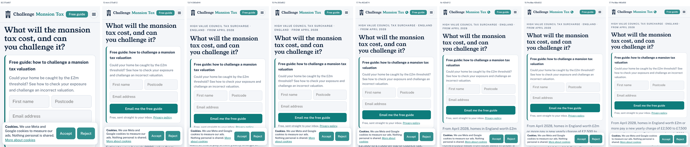
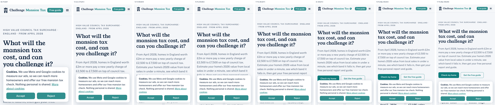
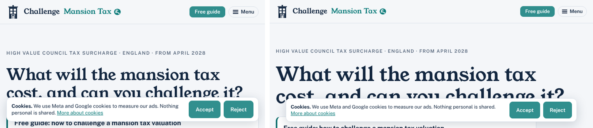

# Read this first

- **The three improvements are not live yet.** The brief says they have been implemented, but the live home page is unchanged: there's no top-of-page form, the cookie card is the old one, and every form field is still 15.2px. The changes exist only as tested code in the Council-Tax-Challenger repository (folder `website-changes/`). The session that wrote them couldn't get access to the website's own repository.
- **So this report tests two versions:**
  - the **live site** as it is today
  - the **proposed changes**, corrected after this test found defects
- **All device testing was simulated.** It used Playwright with Chromium, emulating iPhone screen sizes, touch and the iPhone browser identity. **No physical iPhone was used, and Safari itself was not used.**
- **Exactly one real test sign-up was made on the live site.** It was clearly labelled ("TEST Claude QA", source `test/claude_qa/live_e2e_14nov`), made at 20:13 UTC, with cookies rejected, so no ad conversion was recorded.
- **All other submissions were intercepted** inside the test browser and never reached the site, Google or Meta.

**First screen.** "First screen" means what Safari shows before scrolling. That's taken as 79% of the screen height, allowing for Safari's status bar and address/tab bars (for example 664px on an iPhone 13).

# A. Device testing report

## Proposed version (after corrections), simulated

| Device | Viewport | First-screen form | Cookie banner | Form zoom | Layout | Form submission | Mobile usability |
|---|---|---|---|---|---|---|---|
| iPhone SE (2022) | 375 × 667 | PARTIAL¹ | PASS | PASS | PASS | PASS | PASS |
| iPhone 13 mini | 375 × 812 | PASS | PASS | PASS | PASS | PASS | PASS |
| iPhone 13 / 14 | 390 × 844 | PASS | PASS | PASS | PASS | PASS | PASS |
| iPhone 14 Pro / 15 Pro | 393 × 852 | PASS | PASS | PASS | PASS | PASS | PASS |
| iPhone 16 Pro / 17 Pro | 402 × 874 | PASS | PASS | PASS | PASS | PASS | PASS |
| iPhone Air | 420 × 912 | PASS | PASS | PASS | PASS | PASS | PASS |
| iPhone 15 Pro Max | 430 × 932 | PASS | PASS | PASS | PASS | PASS | PASS |
| iPhone 16 / 17 Pro Max | 440 × 956 | PASS | PASS | PASS | PASS | PASS | PASS |
| Any physical iPhone | n/a | NOT TESTED | NOT TESTED | NOT TESTED | NOT TESTED | NOT TESTED | NOT TESTED |

¹ **iPhone SE:** with the cookie bar showing, the headline, the guide heading and explanation, and the name and postcode fields are visible. The email field and button are hidden behind the bar. As soon as the visitor taps Accept or Reject, the whole form is visible (button bottom at 488px of 527px) without scrolling. Fitting the whole form above the bar on the SE would mean shrinking the text, which the brief rules out.

**What each column checked:**

- **First-screen form:** the guide button is visible and not covered by the cookie bar.
- **Cookie banner:**
  - Accept removes the bar, saves the choice and loads Meta/Google.
  - Reject removes the bar, saves the choice and loads nothing.
  - In landscape the bar uses 16–19% of the screen height.
  - Accept and Reject are 44px tall.
- **Form zoom:** every visible input is 16px or larger. 0 of 18 fields are under 16px.
- **Layout:**
  - no sideways scrolling in portrait or landscape
  - no overlapping elements, apart from the deliberate cookie bar
  - no cut-off text (the only "clipped" element is a hidden label for screen readers)
- **Form submission:** each field was tapped, filled in and submitted. The data was passed to the existing form, and the visitor reached the thanks page.
- **Mobile usability:** the guide button and cookie buttons are all at least 44px tall, and the form keeps the correct autofill hints (given-name, postal-code, email).

## Live site today, simulated

| Device | First-screen form | Cookie banner | Form zoom | Layout | Form submission | Mobile usability |
|---|---|---|---|---|---|---|
| SE 375 × 667 | FAIL (button 3,386px down) | FAIL (184px card; 43% in landscape) | FAIL | PASS² | PASS | FAIL (cookie buttons 34px) |
| 13 mini 375 × 812 | FAIL (3,386px) | FAIL (184px; 43%) | FAIL | PASS² | PASS | FAIL |
| 13 / 14 390 × 844 | FAIL (3,280px) | FAIL (184px; 42%) | FAIL | PASS² | PASS | FAIL |
| 15 Pro 393 × 852 | FAIL (3,280px) | FAIL (184px; 41%) | FAIL | PASS² | PASS | FAIL |
| 17 Pro 402 × 874 | FAIL (3,159px) | FAIL (184px; 41%) | FAIL | PASS² | PASS | FAIL |
| Air 420 × 912 | FAIL (3,110px) | FAIL (162px; 39%) | FAIL | PASS² | PASS | FAIL |
| 15 Pro Max 430 × 932 | FAIL (3,035px) | FAIL (162px; 38%) | FAIL | PASS² | PASS | FAIL |
| 17 Pro Max 440 × 956 | FAIL (3,014px) | FAIL (162px; 37%) | FAIL | PASS² | PASS | FAIL |

² Layout passes at normal text size. At 150% text size the header is too wide for the screen and the page scrolls sideways (see problem 8).

"Form zoom FAIL" means all 8 visible form fields on the live page are 15.2px. Safari zooms the page in when someone taps a field with text under 16px.

## Larger text (simulated)

Safari's "aA" page zoom was simulated by narrowing the page: 150% is about 250px wide and 200% about 195px.

- **150%:** the live site scrolls sideways (header). Proposed: **PASS**.
- **200%:** both versions overflow by about 26px in sections lower down the page (checker results and the "cliff-edge" boxes). **Not fixed** (see problem 9).

# B. Screenshots

All screenshots are in `website-changes/qa-14nov/screenshots/`, one first-screen image per device for each version, plus landscape.

# C. Problems identified, in priority order

1. **The guide form is 3,000–3,400px down the page on phones** (live). Almost every ad visitor is on a phone, and most never scroll that far, so they never see the offer. This is likely the biggest single cause of 0 sign-ups from 36 clicks, after visitor intent. *Fixed in the proposed code.*
2. **The cookie card covers 162–184px of the first screen** (about 25–28%), and 37–43% in landscape (live). It hides the hero buttons and is the first thing a visitor has to deal with. *Fixed (69–85px bar; 16–19% in landscape).*
3. **Every form field is 15.2px, so iPhones zoom in when a field is tapped** (live). The page jumps, and the visitor has to pinch back out to find the button. That's friction at exactly the moment of sign-up. *Fixed (all fields 16px on phones).*
4. **The cookie Accept and Reject buttons are too small:** 34px on the live site and 29px in the first proposed version, against Apple's 44px guideline. Mis-taps are likely. *Fixed (44px).*
5. **The cookie bar still covered the guide button on the iPhone SE and 13 mini** in the first proposed version. *Fixed on the 13 mini; on the SE the button shows once the cookie choice is made (see note 1 above).*
6. **The guide email lands in Gmail's Promotions tab.** This was verified with the one live test. Leads may never see the guide, which hurts follow-up and later sales, though not the sign-up count. *Not fixed: it's an email and domain decision* (see the recommendations).
7. **Google Ads visitors can't be told apart from ordinary Google searches** in Netlify and MailerLite: both show as "www.google.com". You can't see which ad sign-ups came from. *Fixed:* the new form labels ad visits "google-ads". Also add the Final URL suffix in Google Ads so each sign-up shows its keyword.
8. **At 150% text size, the header is too wide** and the page scrolls sideways (live). This affects visitors who use larger text, often older homeowners, who are a core audience. *Fixed.*
9. **At 200% text size, sections lower down overflow by about 26px.** *Not fixed:* it needs changes across several sections of the page, which goes beyond a minor fix.
10. **The Google Ads conversion counts any visit to a page whose address contains "thanks"**, including reloads and direct visits. This could inflate the conversion count slightly. *Not a code fix:* in Google Ads, set the conversion action's **Count** to **One**.

# D. Corrections made (in the proposed code)

All changes keep the existing branding, colours, fonts and wording, apart from the shorter cookie sentence that was already in the proposal.

| Correction | Where |
|---|---|
| Accept and Reject side by side, 44px tall; bar 69–85px tall on phones (was 86px with 29px buttons) | `code/style-additions.css` |
| Landscape: cookie bar on one row (16–19% of the screen, was 31–37%) and less space above the headline, so the form starts on the first screen | `code/style-additions.css` |
| Short phones only (screen up to 650px visible height, i.e. the SE and 13 mini): less space above the headline, and the small "High Value Council Tax Surcharge · England · from April 2028" label hidden. The same facts are in the paragraph below the form. | `code/style-additions.css` |
| Guide button at least 44px tall | `code/style-additions.css` |
| Larger text (page 300px wide or less): header wraps, fact boxes and form fields stack, so there's no sideways scrolling at 150% | `code/style-additions.css` |
| Google Ads visits labelled "google-ads" in the sign-up's source field. Only the label is stored, not Google's click ID. Links with utm tags keep their own label. | `code/hero-signup.js` |

`apply-prompt.txt` contains the complete, corrected code ready to apply in the website repository.

# E. Final verification

After all corrections, the full test was rerun on all 8 iPhone sizes, in portrait, landscape and at 150% and 200% text size. The results are in the tables in section A. The raw numbers are in `results/proposed-matrix.json` and `results/live-matrix.json`.

The source-label change was tested three ways:

| Visit | Source recorded |
|---|---|
| Ad click (gclid only) | `google-ads/hero` |
| Ad click with the recommended URL suffix | `google/search-test/{keyword}/hero` |
| Direct visit | `direct/hero` |

# Conversion tracking

Wherever this section says **verified**, the result was seen happening. "In the browser" means the request left the page with the right content. Those requests were caught before reaching Google or Meta, so no fake conversions were recorded. Nothing was checked inside the Google Ads or Meta accounts, because this session has no access to them.

| # | Check | Result |
|---|---|---|
| 1 | Google Ads records completed free-guide requests | **Verified in the browser; not verified in Google Ads.** After Accept, the thanks page sends a conversion to Google Ads account AW-18562300609 with conversion label `gAenCKqyhLUdEMH1mJNF` and the ad-click ID. Still to check in Google Ads: Goals → Conversions shows this action as **Active / Recording**, it's set as a primary goal, and Count is **One**. |
| 2 | Google Tag Manager configuration | **Verified.** Container GTM-WBSQWTFV is a Google tag for AW-18562300609. Its conversion rule is "page_view where the page address contains *thanks*". It only loads after Accept. The site's extra `generate_lead` event also reaches Google but isn't used as the conversion, which is harmless. |
| 3 | Meta Pixel events | **Verified in the browser; not verified in Meta Events Manager.** Pixel 2104372500283712 sends PageView on each page and **Lead** on the thanks page, once per sign-up, only after Accept. |
| 4 | Campaign attribution | **Verified in the browser.** Google's click ID reaches the conversion even when the visitor only accepts cookies on the thanks page: Google reads it from the previous page's address. In Netlify and MailerLite, ad visits were not distinguishable before; that's fixed in the proposed code. Also add the Final URL suffix in Google Ads. |
| 5 | Telling genuine enquiries from tests | **Verified.** Visit with `?utm_source=test&utm_campaign=...` and the sign-up's source starts with `test/` in both Netlify and MailerLite ("came_from"), as in your earlier "test/simon_test" entries and this test's "test/claude_qa/live_e2e_14nov". Use +test email addresses as well. |
| 6 | Sign-ups recorded when cookies are rejected, with no tracking before consent | **Verified.** With Reject, the browser made **zero** requests to Google or Meta (scripts or beacons). The sign-up was still saved in Netlify and MailerLite: the live test raised Netlify guide-signup from 26 to 27, and MailerLite added the subscriber to "Guide only". Before a choice is made, nothing loads. |

**One live end-to-end test** (iPhone 13 simulation, cookies rejected, 20:13 UTC):

- the form was accepted (HTTP 200)
- the thanks page loaded and its "Download your free guide now (PDF)" link returned the 5-page PDF
- MailerLite sent "Your free mansion tax guide", which **arrived in Gmail 6 seconds later, in the Promotions tab**

Earlier records show no genuine sign-ups from the 36 ad clicks (11–14 November). Every guide sign-up since 9 November was a test.

# Conversion review: the page from an ad visitor's point of view

**What works well:**

- The headline ("What will the mansion tax cost, and can you challenge it?") matches the searches.
- The free checker is a strong, relevant tool, and the "£1 more in value can cost £2,500 a year" section is persuasive.
- Free and paid are clearly separated: the Evidence Pack (£199 introductory, then £299) appears only in step 2 of "How it works".
- The thanks page is clear ("Check your inbox"), gives an instant PDF download, and tells people to check Promotions.

**Recommendations (need your approval, since they change content):**

1. **Show credibility next to the form.** Add one line under the guide form, such as "Prepared by [name / qualification], using HM Land Registry sales data." There's no named expert or credential near the offer at the moment.
2. **Say what's inside the guide.** For example: "5-page guide: how the bands work, the 2026 evidence checklist, and how appeals will work." Specifics make the email swap feel worthwhile.
3. **Point the header "Free guide" button at the new top form** on the home page. It currently jumps to the lower form, about 3,000px down.
4. **Make the guide email more likely to land in the main inbox:**
   - send it as plain text
   - ask people on the thanks page to drag it into Primary
   - check SPF, DKIM and DMARC for challengemansiontax.co.uk in MailerLite
5. **Keep the checker and the guide form working together.** The quick guide form captures visitors who want something now; the checker gives a personal report. On the thanks page, invite guide sign-ups to try the checker next.

No redesign is recommended.

# F. Summary

**Fixed (in the proposed code, not yet live):**

- a top-of-page guide form
- a slim cookie bar with 44px buttons that works in landscape
- no iPhone zoom on form fields
- no sideways scrolling at 150% text size
- correct layout on the iPhone SE and 13 mini
- Google Ads visits labelled in the sign-up records

**Tested:**

- 8 simulated iPhone sizes in portrait, landscape and larger text, for both the live and proposed versions
- consent behaviour (Accept and Reject)
- Google Ads and Meta Pixel firing in the browser
- attribution
- one labelled live sign-up, from form through to email delivery

**Still not verified:**

- any physical iPhone or real Safari, including Safari autofill (the correct autofill hints are in place)
- whether Google Ads and Meta show the events in their dashboards
- the proposed code on the real site: it must be applied and checked on the Netlify deploy preview

**Is the site ready for another Google Ads test?**

**Not yet.** It will be after these four steps:

1. Apply the proposed changes (use `apply-prompt.txt` in a session that has the website repository).
2. Check the deploy preview on a real iPhone, then merge.
3. In Google Ads, confirm the conversion action is Active, with Count set to One, and add the Final URL suffix and negative keywords.
4. Fix billing and the campaign end date.

At that point the page is in a fit state to test. Judge the results after about 200 more clicks.
